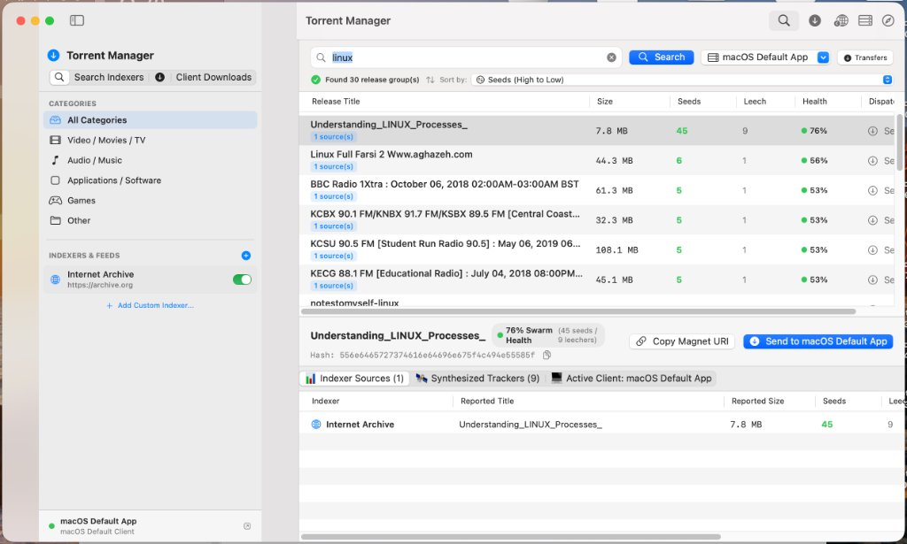
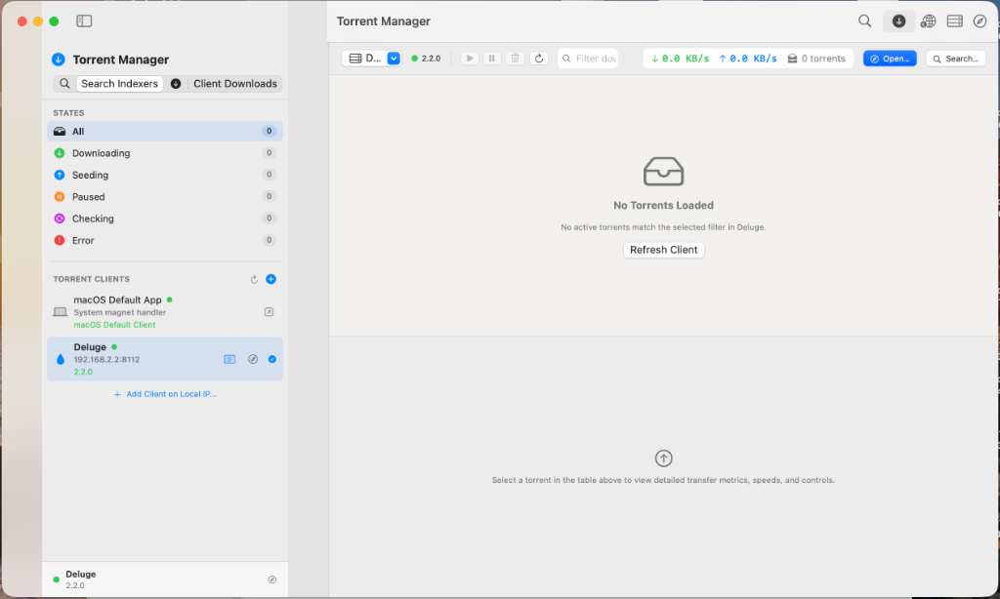
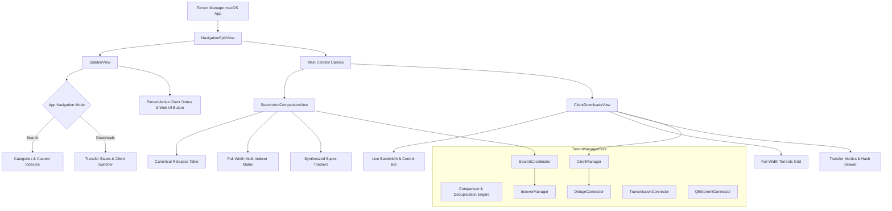

# Torrent Manager for macOS

<p align="center">
  
  <br>
  <strong>A high-performance, native macOS BitTorrent manager built with Swift 6 and SwiftUI.</strong>
  <br>
  <em>Unified multi-indexer search, swarm deduplication, super-magnet synthesis, and Deluge-style client transfers management.</em>
</p>

<p align="center">
  
  
  
  
</p>

---

## 📸 Screenshots

| Multi-Indexer Search & Comparison Matrix | Deluge-Style Transfers Dashboard |
|:---:|:---:|
|  |  |

---

## ✨ Key Features

### 🔍 Extensible Multi-Indexer Search
- **Pluggable Architecture**: Add custom indexers dynamically without recompiling.
- **Torznab & Prowlarr / Jackett**: Native support for standard Torznab XML/JSON feeds to tap into personal indexer pools.
- **Custom REST/JSON APIs**: Point to any REST endpoint providing torrent search data.
- **Internet Archive Built-In**: Fast public domain archives, media, and open collections searching.

### ⚖️ Comparison & Deduplication Engine
- **Info-Hash Grouping**: Automatically collapses identical releases reported across different indexers into a single canonical entry.
- **Swarm Health Scoring**: Computes a swarm health percentage ($0 - 100\%$) weighting active seed counts, seed-to-peer ratios, and availability.
- **Super-Magnet Synthesizer**: Aggregates distinct announce trackers across all reporting indexers into a single consolidated magnet URI for optimal peer discovery.
- **Side-by-Side Release Verification**: Compare reported titles, sizes, seed/leech counts, and trust states in an expanded full-width matrix to spot discrepancies or corrupted uploads before downloading.

### 📥 Deluge-Style Client Transfers Dashboard
- **Live Transfer Strip**: Monitor real-time download and upload speeds, active torrent counts, and client connection health.
- **Full-Width Torrent Grid**: Sort and inspect downloads with visual progress bars, state indicators, down/up bandwidth, seed/peer ratios, and ETA calculations.
- **Transfer State Filtering**: Quick-filter by states: *All*, *Downloading*, *Seeding*, *Paused*, *Checking*, or *Error*.
- **Detailed Lower Notebook**: Inspect completed size, elapsed time, swarm metrics, and copy info-hashes with one click.
- **Torrent Controls**: Pause, resume, and remove transfers (with optional local data deletion).
- **Auto-Refresh**: Live updates polled reactively via Swift Concurrency tasks.

### 🔌 Multi-IP Torrent Client Management
- **Local & Remote Daemon Support**: Seamlessly connect to **Deluge** (Web JSON-RPC), **Transmission** (RPC), or **qBittorrent** (Web API v2) running locally, in Docker, or on your LAN/NAS (e.g., `192.168.2.2:8112`).
- **macOS System Handler**: Fallback system handoff via `NSWorkspace` for handling `magnet://` links with your default macOS torrent app.
- **One-Click Launch**: Direct shortcuts to launch client Web UIs in your default browser or switch between configured clients on the fly.

---

## 🏗️ Architecture



---

## 📂 Project Structure

```
├── Makefile                           # Build, test, and install automation
├── Package.swift                      # Swift 6 Package Manifest
├── docs/screenshots/                  # App screenshots and visual assets
├── Resources/
│   ├── AppIcon.icns                   # macOS Application Icon
│   └── AppIcon.png
├── Sources/
│   ├── TorrentManagerCore/            # Core business logic framework
│   │   ├── Models/
│   │   │   └── TorrentModels.swift    # Data models, transfer states, SwarmHealth algorithm
│   │   ├── Indexers/
│   │   │   ├── TorrentIndexer.swift   # Indexer protocol & capabilities
│   │   │   ├── CustomRESTIndexer.swift# User-configured REST/JSON indexer client
│   │   │   ├── TorznabIndexer.swift   # Standard Torznab (Jackett/Prowlarr) client
│   │   │   ├── ArchiveOrgIndexer.swift# Internet Archive scraper/API client
│   │   │   ├── IndexerProfile.swift   # Indexer persistence models
│   │   │   └── IndexerManager.swift   # Thread-safe pluggable indexer actor
│   │   ├── Comparison/
│   │   │   └── ComparisonEngine.swift # Info-hash deduplication & tracker synthesizer
│   │   ├── Clients/
│   │   │   ├── TorrentClientProtocol.swift # Unified client abstraction
│   │   │   ├── DelugeConnector.swift  # Deluge JSON-RPC web daemon connector
│   │   │   ├── TransmissionConnector.swift # Transmission RPC connector
│   │   │   ├── QBittorrentConnector.swift  # qBittorrent Web API connector
│   │   │   ├── LocalClientConnector.swift  # macOS NSWorkspace magnet dispatcher
│   │   │   ├── ClientProfile.swift    # Multi-IP profile storage
│   │   │   ├── ClientStatus.swift     # Telemetry and transfer statistics
│   │   │   └── ClientManager.swift    # Multi-client routing and proxy actor
│   │   └── Search/
│   │       └── SearchCoordinator.swift# Async parallel indexer orchestrator
│   └── TorrentManager/                # SwiftUI macOS Application
│       ├── TorrentManager.swift       # Entry point, NSApplicationDelegate, CLI router
│       └── UI/
│           ├── ContentView.swift      # Main split-view container & toolbar
│           ├── SidebarView.swift      # Modern navigation sidebar
│           ├── SearchAndComparisonView.swift # Master table & comparison matrix
│           ├── ClientDownloadsView.swift # Deluge-style transfers dashboard
│           ├── TorrentSearchViewModel.swift # Unified reactive view model
│           ├── AddClientSheet.swift   # Client setup dialog
│           └── AddIndexerSheet.swift  # Custom indexer dialog
└── scripts/
    └── build_and_export_app.sh       # Release packaging & ad-hoc code signing pipeline
```

---

## 🚀 Getting Started

### Prerequisites
- macOS 14.0 (Sonoma) or macOS 15.0+ (Sequoia)
- Xcode 15+ / Command Line Tools with Swift 6.0 support

### Build & Install to `/Applications`
Compile the optimized release binary, assemble the `.app` bundle with high-resolution icons, and install directly into `/Applications`:

```bash
make install
```

The application will be available in Spotlight and Finder as **Torrent Manager.app**.

### Development Build
To compile in debug mode during development:

```bash
make build
# or: swift build
```

### CLI Mode & Diagnostics
Torrent Manager includes built-in command-line diagnostic utilities:

```bash
# Run client and indexer connectivity diagnostics:
swift run TorrentManager --cli

# Perform a quick CLI search across configured indexers:
swift run TorrentManager --search "ubuntu"

# Launch directly into the Client Downloads transfers view:
open "/Applications/Torrent Manager.app" --args --downloads
```

---

## 🔒 Privacy & Compliance

Torrent Manager is designed strictly as a network utility, search aggregator, and BitTorrent client interface:
- **No Embedded Directories**: The application does not ship with hardcoded links to pirated content or questionable portals.
- **User-Configured Feeds**: All custom indexers, Torznab feeds, and client credentials are fully user-managed and stored locally on the user's machine.
- **Objective Telemetry**: Metrics are presented neutrally without subjective moral classifications.

---

## 📄 License

This project is licensed under the [MIT License](LICENSE).
